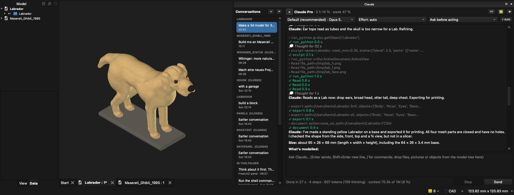
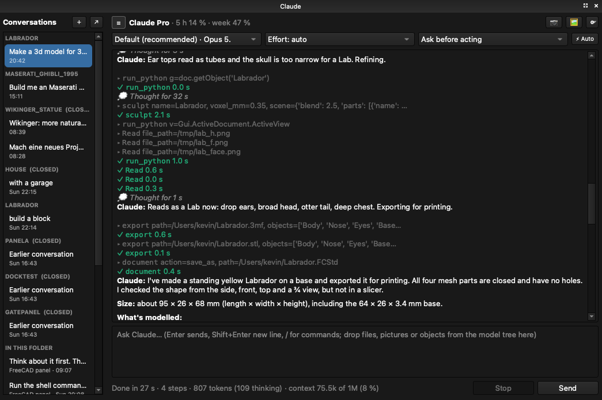
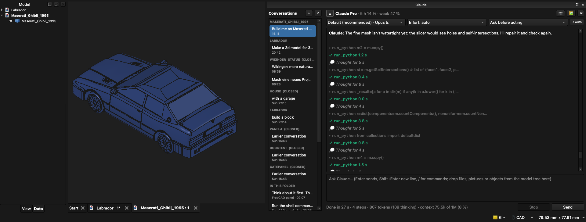

# FreeCadClaudeBridge

Control FreeCAD by chat with Claude, either in a **"Claude" chat panel inside FreeCAD** or from **Claude Code**. Claude works on your open document through FreeCAD's Python API: it creates and changes geometry, reads the model tree and properties, and exports files. Every Claude step is exactly one undo step, and failed code leaves nothing behind.



*"Make a 3D model of a Labrador for printing": Claude sculpted it with the `sculpt` tool, looked at it from four sides, refined ears and skull, and exported 3MF and STL. Real screenshot of FreeCAD 1.1 on macOS.*

> Status: 1.12.0, not yet tagged. Tested by hand on macOS; Linux (AppImage) and Windows (portable build) are tested in CI against FreeCAD 1.1.4, including the GUI on Linux. The release is tagged after the [manual acceptance](docs/manual-testing.md) on Windows 11 and Ubuntu. See [CHANGELOG.md](CHANGELOG.md).

## Install

You need **[FreeCAD](https://www.freecad.org/downloads.php) 1.0 or newer** and **[Claude Desktop](https://claude.ai/download)**, installed and signed in (on Linux, where there is no Claude Desktop, [Claude Code](https://claude.com/claude-code) is enough). Then start the setup, which opens a window:

**Double-click:** download [Install FreeCAD Claude.command](installer/Install%20FreeCAD%20Claude.command) (macOS; the first time right-click it and choose *Open*) or [Install FreeCAD Claude.cmd](installer/Install%20FreeCAD%20Claude.cmd) (Windows) and open it.

**Or run one line:**

**macOS / Linux** (Terminal):

```bash
curl -fsSL https://raw.githubusercontent.com/Scharmen/FreeCadClaudeBridge/main/install.sh | sh
```

**Windows** (PowerShell):

```powershell
irm https://raw.githubusercontent.com/Scharmen/FreeCadClaudeBridge/main/install.ps1 | iex
```

The setup window shows a checklist and walks you through it (a missing item gets a **Download** button, questions come as dialogs, *Show details* shows what runs):

1. It checks for FreeCAD, Claude Desktop, Claude Code (the `claude` command the panel uses) and your Claude sign-in. Whatever is missing is named with its download page, which it offers to open; nothing is changed until everything is there.
2. If only Claude Code or the sign-in is missing, it offers to fix that right away: the official Claude Code installer, and `claude auth login` in your browser (use the same account as in Claude Desktop). It also installs [uv](https://docs.astral.sh/uv/) if needed, after asking.
3. It installs the `freecad` plugin into Claude and the Claude panel into FreeCAD, then offers to start FreeCAD; the "Claude" panel appears docked on the right.

Run it again any time to update or repair. `… | sh -s -- --no-gui` stays in the terminal; `… | sh -s -- --yes` answers every question with the default, without a window (on Windows set `$env:FREECAD_BRIDGE_WIZARD_ARGS = "--no-gui"` first). Without a display or Tk the setup continues in the terminal.

<details><summary>Manual install (for developers)</summary>

1. **Install uv** (once): `curl -LsSf https://astral.sh/uv/install.sh | sh` (macOS/Linux), `brew install uv`, or on Windows `winget install --id=astral-sh.uv -e`.
2. **Install the plugin in Claude Code:**
   ```
   /plugin install freecad --marketplace Scharmen/FreeCadClaudeBridge
   ```
   On Claude Code older than 2.1.275: `/plugin marketplace add Scharmen/FreeCadClaudeBridge`, then `/plugin install freecad@freecad-claude`.
3. **Set up:** run `/freecad:setup` in Claude Code. It finds FreeCAD (macOS app, Windows install or portable folder, Linux package or AppImage; pass `--freecad <path>` if it isn't found), copies the ClaudeBridge addon into FreeCAD's `Mod` folder and records the path to Claude Code. Then (re)start FreeCAD; the "Claude" panel appears docked on the right.

Check everything with `/freecad:status`.

</details>

**Settings:** FreeCAD → *Preferences → Claude Bridge* (or ⚙ → Settings… in the chat panel), `/freecad:settings` in Claude Code, or `freecad-bridge settings` in a terminal. There you set how much memory a headless job may use (as a share of this computer's RAM, plus what always stays free), its default time limit, and whether the bridge and chat panel start with FreeCAD.

**Update:** run `claude plugin marketplace update freecad-claude` and `claude plugin update freecad@freecad-claude` in a terminal (or turn on auto-update for the `freecad-claude` marketplace in `/plugin`), then restart Claude Code. The next session replaces the addon on its own; restart FreeCAD to load it.

**Remove:** `/freecad:setup --uninstall` removes the addon, token, config, instance files and the stored API key; add `--purge` to also delete snapshots, chat history and the audit log. Then `/plugin uninstall freecad@freecad-claude`.

## Use





*Left: the chat panel with conversations grouped by project, model, effort and permission mode, plan usage, every tool call and the turn summary. Right: a Maserati Ghibli (1995) built from the user's photo; here Claude checks the print mesh and repairs it until it is watertight.*

- **In FreeCAD:** type into the Claude panel, e.g. "Make a 40×30×10 mm block with a 10 mm hole in the middle and export it as STEP to ~/Desktop/block.step". The active document and your current selection are sent along, so "make this face 2 mm thicker" works. Tool calls show up as rows, followed by a summary of created/changed objects and any errors; **Stop** ends the turn. Each document keeps its own conversations in a sidebar on the left (☰ hides it): click to switch, ＋ starts one, right-click to rename, delete or open it in the Desktop app. They are normal Claude Code sessions: ↗ opens the current one in the Claude Desktop app, and sessions you started in a terminal or the Desktop app in the same folder appear in the list to continue here. 📷 inserts a picture of the 3D view. If Claude needs a tool the panel doesn't allow, a link lets you allow it for that conversation. Toggle the panel with Ctrl+Alt+K or the *Claude* menu of the "Claude Bridge" workbench.
- **In Claude Code:** just ask; the `freecad` tools talk to the running FreeCAD.
- **From a picture:** attach one with 🖼 in the chat panel, or give Claude a file path ("make a 3 mm thick keychain from ~/logo.png", "revolve this vase silhouette to 12 cm", "a relief plaque from this photo"). Everything runs locally; nothing is uploaded except what Claude sees in the conversation.
- **Learning:** after each model the panel asks 👍/👎 (Claude Code asks in a line). What you say becomes short lessons in `preferences.md` that every new session follows; view, edit or forget them under *Preferences → Claude Bridge* or with `freecad-bridge preferences`.
- **Several FreeCAD windows:** the chat panel always works on the FreeCAD it belongs to. In Claude Code, calls go to the most recently started FreeCAD and the result says so; ask Claude to switch ("work in the FreeCAD that has Flange open"), which uses `instances` and `select_instance`. The choice lasts for the Claude Code session.
- **Full Claude Code in the panel:** every Claude Code tool is available; anything your Claude Code settings don't already allow asks in the chat with Allow once / Always / Deny buttons (also in a bar above the input); questions Claude asks come with one button per option. Switch on **⚡ Auto** to allow everything, answer questions with the recommended option and accept plans without being asked. Pick model, effort and permission mode above the chat, type `/` for commands (Claude Code's, your skills', and `/clear`, `/model`, `/effort`, `/mode`, `/desktop`, `/help`), keep typing while Claude works (messages queue), and Stop interrupts the current step.
- **Drag and drop:** drop or paste pictures (sent as images), files and folders (Claude reads them), CAD files (with an "Import into FreeCAD" link) or objects from the model tree (sent as references) onto the chat; drag pictures out of it; drag conversations in the sidebar to reorder, right-click to pin or move them to another document.
- **When something goes wrong:** the status line shows what Claude is doing right now; if it goes quiet for two minutes the chat says whether FreeCAD is still computing or Claude seems stuck. ⚙ → **Create debug report** writes one file with everything needed to find the problem (secrets redacted). If FreeCAD crashes during a Claude call, the next start says which call it was; FreeCAD's document recovery and the bridge's automatic copies keep your work.
- **Why it looks like this:** Claude says what it will build and on which proportions and facts before it starts, and afterwards explains its main decisions with reasons and sources, marking what it assumed. The same notes are saved in the document ("Design notes", double-click to read) and shown with the 📝 link after a turn.
- **Usage:** the header shows your plan's usage (5-hour and weekly limit, orange from 80 %, reset times on hover) as Claude reports it with every answer; after each answer the status line shows the tokens Claude wrote (thinking included) and how full the context is. `/usage` shows it in the chat. The model menu says which model "Default" currently is.
- **Login:** the panel uses your Claude subscription (Claude Code's login) by default. Switch to pay-as-you-go with **⚙ → Use API key**; the key is stored in the macOS Keychain, Windows Credential Manager or Linux Secret Service, never in FreeCAD's settings.

## Tools

27 tools; in Claude Code they are named `mcp__plugin_freecad_freecad__<tool>`.

- **Read:** `status`, `instances`, `get_preferences`, `get_tree`, `get_object`, `inspect_shape` (faces/edges with geometry), `inspect_sketch` (constraints, degrees of freedom, conflicts), `get_changes` (what you did in the GUI meanwhile), `get_console` (Report view), `api_help` (API of the installed FreeCAD), `list_commands`.
- **Act:** `run_python` (one undo step per call, rolled back on errors), `run_command`, `task_dialog`, `selection`, `document`, `export`, `import`, `view` (optional screenshot), `run_headless` (heavy work in a separate `freecadcmd` process so FreeCAD stays responsive; stopped before it exhausts memory, with a budget derived from the machine's RAM), `snapshot`, `select_instance`, `image_to_3d` (picture → outline extrusion/revolve, relief mesh or reference plane, all local), `sculpt` (organic forms such as figures, faces, hair, animals, rocks from smoothly blended primitives, like clay, imported as watertight matte meshes), `compare_to_picture` (the user's picture next to the model from the matching view, to find what is missing), `design_notes` (why the model looks the way it does: each decision with its reason and source, saved in the document), `record_feedback`.

Allow all of them with `mcp__plugin_freecad_freecad__*` in `permissions.allow` (note that `run_python` runs arbitrary code in FreeCAD). The bundled skill carries tested FreeCAD 1.1 patterns for Part, PartDesign, Sketcher, Assembly, TechDraw, VarSet/Spreadsheet and export, plus guides for model quality (workflow, robust sketches, a realistic look, printability) and organic shapes.

## Troubleshooting

`/freecad:status` checks everything and prints a fix for each problem. The common ones:

| Message | Fix |
| --- | --- |
| `NOT_RUNNING` | Start FreeCAD. If it runs but the Claude panel is missing, run `/freecad:setup` and restart FreeCAD. On Windows, security software may block 127.0.0.1. |
| `AUTH_FAILED` | Claude Code and FreeCAD use different tokens: run `/freecad:setup`, restart FreeCAD. |
| `VERSION_MISMATCH` or "FreeCAD still runs ClaudeBridge x" | Restart FreeCAD; if that is not enough, `claude plugin update freecad@freecad-claude` and `/freecad:setup`. |
| `GUI_BUSY` / `TIMEOUT` | FreeCAD is busy with a long operation. Wait, and let Claude use `run_headless` for heavy geometry. |
| FreeCAD not found by `/freecad:setup` | `/freecad:setup --freecad <FreeCAD.app, install folder or AppImage>` |

## Security

The addon listens only locally (Unix socket with permissions 0600; TCP on 127.0.0.1 on Windows) and both sides authenticate with a 32-byte token (mutual HMAC-SHA256); rotate it with *Claude → Rotate token* in FreeCAD or `freecad-bridge token --rotate`. Every call, with its code, is recorded in an audit log in the bridge folder (*Claude → Open audit log*). `run_python` is full code execution with your user rights by design; Claude Code's permission prompts are the second barrier. Treat FCStd files from unknown sources like code. Details and known limits: [docs/security.md](docs/security.md).

## Development

```bash
make test     # unit tests, no FreeCAD needed
make itest    # GUI integration tests against a running FreeCAD with the addon (incl. every skill snippet)
make lint
make validate # claude plugin validate .
```

Layout: `plugin/` is the Claude Code plugin (`server/` = Python package `freecad-bridge`, `addon/ClaudeBridge/` = FreeCAD addon, `skills/`, `commands/`, `hooks/`). `uvx --from plugin/server` rebuilds automatically after code changes (sources are uv cache keys). Restart FreeCAD to load a changed addon. Conventions are in [CLAUDE.md](CLAUDE.md).

## License

MIT
