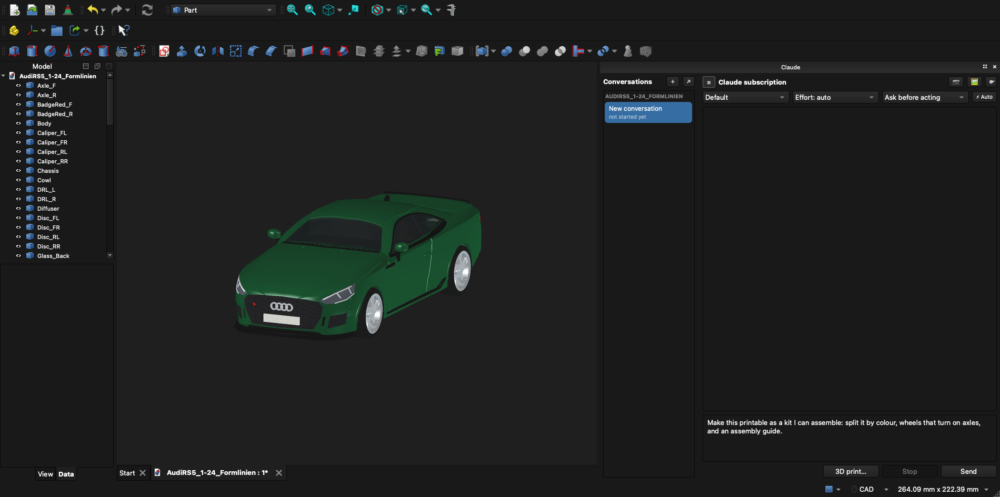
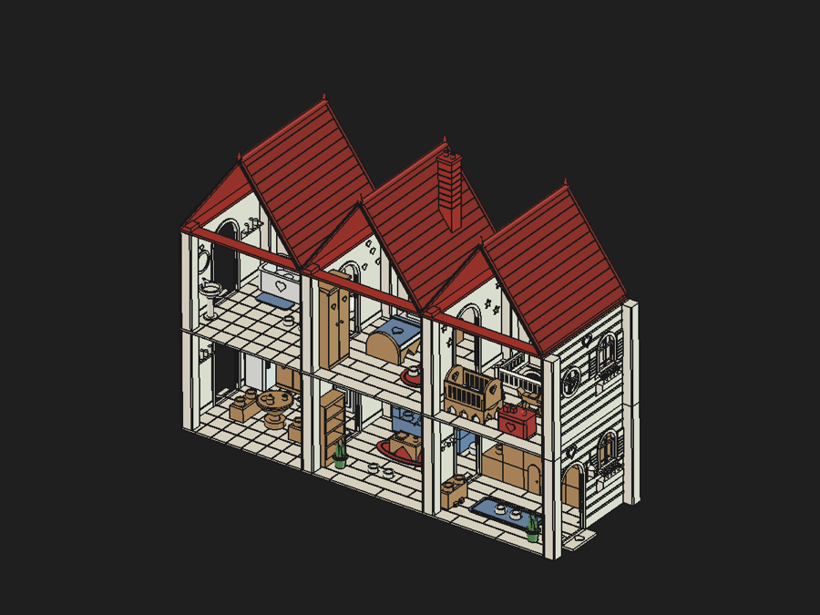
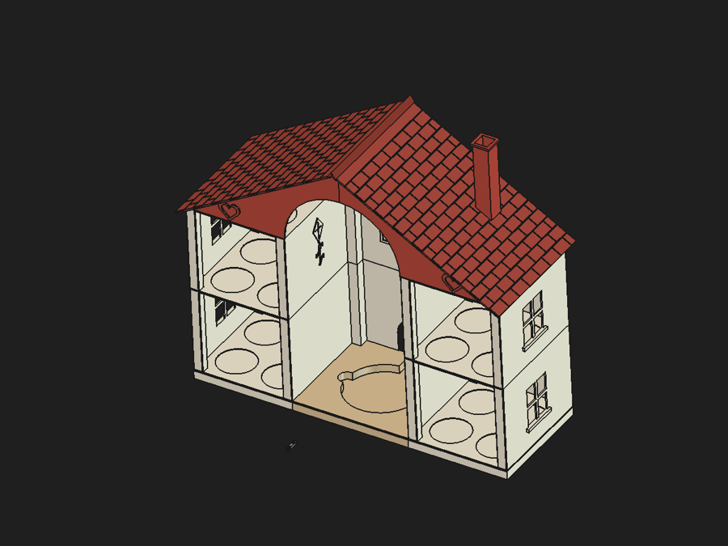
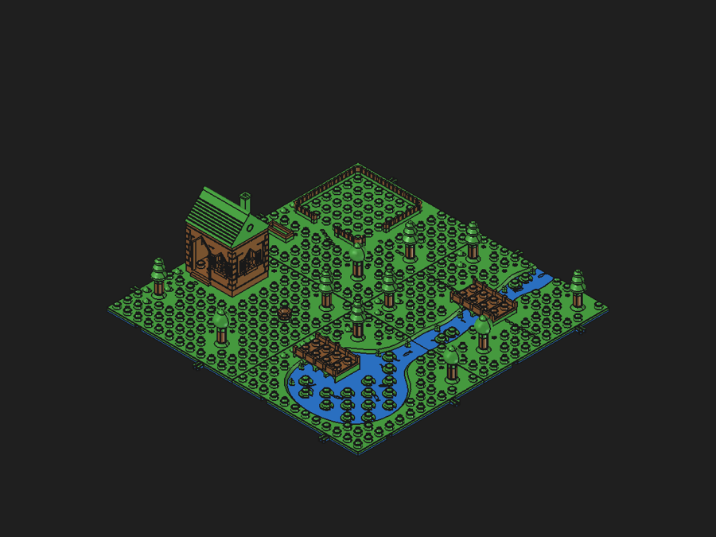
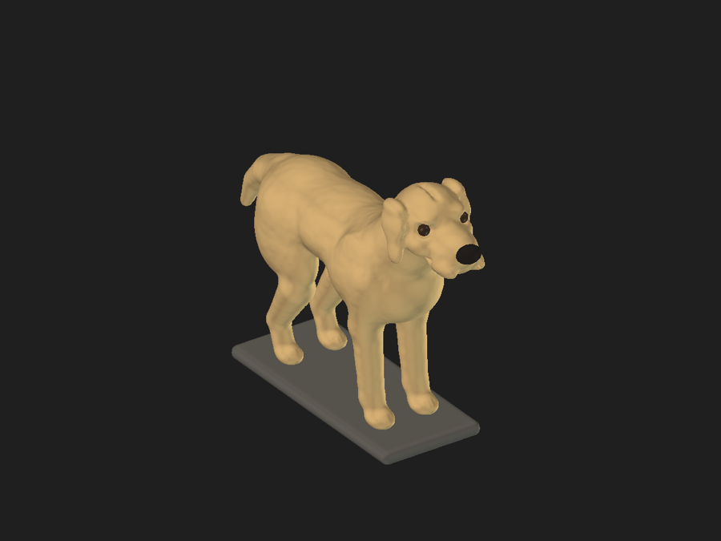
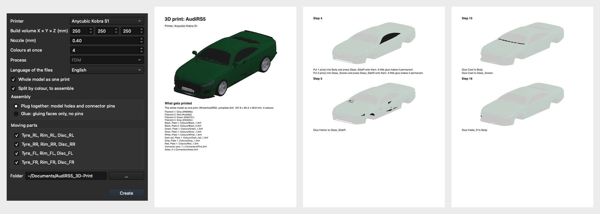
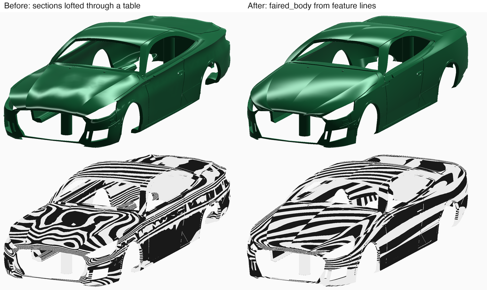

# FreeCadClaudeBridge

Control FreeCAD by chat with Claude, either in a **"Claude" chat panel inside FreeCAD** or from **Claude Code**. Claude works on your open document through FreeCAD's Python API: it creates and changes geometry, reads the model tree and properties, and exports files. Every Claude step is exactly one undo step, and failed code leaves nothing behind.



*FreeCAD 1.1 with the Claude panel and an Audi RS5 (1:24, 68 parts) that Claude built from photos for 3D printing. The **3D print…** button in the panel starts the print export (see [Printing](#printing)). The text in the input box is an example and was not sent. Real screenshot of FreeCAD 1.1 on macOS.*

### Made by chat

Not only cars: these were built in the chat panel for 3D printing, from a few sentences each (renders of the real files).

| | |
|---|---|
|  |  |
| **Dollhouse for a two-year-old:** three modules that click together, two floors, kitchen, living room, bathroom, bedroom and nursery, every piece sized for small hands | **Tonie storage house:** a slot for every figure on two floors, a tiled roof with chimney, printable in a few parts |
|  |  |
| **Play board:** 20 × 20 cm of Duplo-compatible tiles with a house, a fenced pasture, trees, a river and bridges | **Labrador:** an organic figure from the `sculpt` dog template, one watertight print |

> **Status: 1.21.1, not yet tagged.** Tested by hand on macOS; Linux (AppImage) and Windows (portable build) are tested in CI against FreeCAD 1.1.4, including the GUI on Linux. The release is tagged after the [manual acceptance](docs/manual-testing.md) on Windows 11 and Ubuntu. See [CHANGELOG.md](CHANGELOG.md).
>
> **New in 1.21.1:** sub chats for single parts of a model, one folder per model (`~/Documents/FreeCAD Projects/<Name>/` with `exports/`, `print/`, `references/`), a clicked conversation opens its model, a richer chat with tables and symbols, update from inside FreeCAD, the addon version in the panel and the plan shown right after an upgrade. **1.21.0:** `make_part` families `wheel`, `lamp` and `pattern` for vehicles, close-ups in `compare_to_picture`, the `hair` preset and poses for `sculpt` templates. **1.20.0:** `make_part` family `thread` (bottle necks, caps, plugs) and `sculpt(one_piece=true)` for figures printed as one piece. **1.19.0:** leaner sessions: `check_all` (every check in one call), previews from `sculpt` and `make_part`, close-ups with `view(look_at=...)`, 28 tools instead of 35, and errors that say what happened; the benchmark records tokens per task. **1.18.0:** the 3D print export button (whole model or split by colour, connectors, axles, PDF guide); `make_part` family `faired_body` and the `check_surface` tool for smooth car and boat bodies; standard parts (gears, springs, bolts, hinges, boxes and more) from tested builders; better person and dog templates for `sculpt`.
>
> **Not verified yet:** nothing from the print export has been printed or assembled, so the fit of pins and axles is untested. On the RS5 most joints of the hollow model are glued, because 1.5 mm walls have no room for pin holes. Models of people and animals are still the weakest area (fur and clothing folds often fail the benchmark's visual check), and cars still miss fine detail such as lamp internals and wheel designs.

## Install

You need **[FreeCAD](https://www.freecad.org/downloads.php) 1.0 or newer** and **[Claude Desktop](https://claude.ai/download)**, installed and signed in (on Linux, where there is no Claude Desktop, [Claude Code](https://claude.com/claude-code) is enough). Then start the setup, which opens a window:

**Double-click:** download [Install FreeCAD Claude.command](installer/Install%20FreeCAD%20Claude.command) (macOS; the first time right-click it and choose *Open*) or [Install FreeCAD Claude.cmd](installer/Install%20FreeCAD%20Claude.cmd) (Windows) and open it.

**Or run one line:**

**macOS / Linux** (Terminal):

```bash
curl -fsSL https://raw.githubusercontent.com/Scharmen/FreeCadClaudeBridge/main/install.sh | sh
```

**Windows** (PowerShell):

```powershell
irm https://raw.githubusercontent.com/Scharmen/FreeCadClaudeBridge/main/install.ps1 | iex
```

The setup window shows a checklist and walks you through it (a missing item gets a **Download** button, questions come as dialogs, *Show details* shows what runs):

1. It checks for FreeCAD, Claude Desktop, Claude Code (the `claude` command the panel uses) and your Claude sign-in. Whatever is missing is named with its download page, which it offers to open; nothing is changed until everything is there.
2. If only Claude Code or the sign-in is missing, it offers to fix that right away: the official Claude Code installer, and `claude auth login` in your browser (use the same account as in Claude Desktop). It also installs [uv](https://docs.astral.sh/uv/) if needed, after asking.
3. It installs the `freecad` plugin into Claude and the Claude panel into FreeCAD, then offers to start FreeCAD; the "Claude" panel appears docked on the right.

Run it again any time to update or repair. `… | sh -s -- --no-gui` stays in the terminal; `… | sh -s -- --yes` answers every question with the default, without a window (on Windows set `$env:FREECAD_BRIDGE_WIZARD_ARGS = "--no-gui"` first). Without a display or Tk the setup continues in the terminal.

<details><summary>Manual install (for developers)</summary>

1. **Install uv** (once): `curl -LsSf https://astral.sh/uv/install.sh | sh` (macOS/Linux), `brew install uv`, or on Windows `winget install --id=astral-sh.uv -e`.
2. **Install the plugin in Claude Code:**
   ```
   /plugin install freecad --marketplace Scharmen/FreeCadClaudeBridge
   ```
   On Claude Code older than 2.1.275: `/plugin marketplace add Scharmen/FreeCadClaudeBridge`, then `/plugin install freecad@freecad-claude`.
3. **Set up:** run `/freecad:setup` in Claude Code. It finds FreeCAD (macOS app, Windows install or portable folder, Linux package or AppImage; pass `--freecad <path>` if it isn't found), copies the ClaudeBridge addon into FreeCAD's `Mod` folder and records the path to Claude Code. Then (re)start FreeCAD; the "Claude" panel appears docked on the right.

Check everything with `/freecad:status`.

</details>

**Settings:** FreeCAD → *Preferences → Claude Bridge* (or ⚙ → Settings… in the chat panel), `/freecad:settings` in Claude Code, or `freecad-bridge settings` in a terminal. There you set how much memory a headless job may use (as a share of this computer's RAM, plus what always stays free), its default time limit, and whether the bridge and chat panel start with FreeCAD.

**Update:** run `claude plugin marketplace update freecad-claude` and `claude plugin update freecad@freecad-claude` in a terminal (or turn on auto-update for the `freecad-claude` marketplace in `/plugin`), then restart Claude Code. The next session replaces the addon on its own; restart FreeCAD to load it.

**Remove:** `/freecad:setup --uninstall` removes the addon, token, config, instance files and the stored API key; add `--purge` to also delete snapshots, chat history and the audit log. Then `/plugin uninstall freecad@freecad-claude`.

## Use


*The chat panel on the dollhouse (a real Haiku answer): conversations per model with a 🧩 sub chat for the ground floor, plan and usage, model, effort and permission mode, Claude's answer as a table with status symbols, and the ⏱ footer with time, steps and tokens.*

- **In FreeCAD:** type into the Claude panel, e.g. "Make a 40×30×10 mm block with a 10 mm hole in the middle and export it as STEP to ~/Desktop/block.step". The active document and your current selection are sent along, so "make this face 2 mm thicker" works. Tool calls show up as rows, followed by a summary of created/changed objects and any errors; **Stop** ends the turn. Each document keeps its own conversations in a sidebar on the left (☰ hides it): click to switch, ＋ starts one, right-click to rename, delete or open it in the Desktop app. They are normal Claude Code sessions: ↗ opens the current one in the Claude Desktop app, and sessions you started in a terminal or the Desktop app in the same folder appear in the list to continue here. 📷 inserts a picture of the 3D view. If Claude needs a tool the panel doesn't allow, a link lets you allow it for that conversation. Toggle the panel with Ctrl+Alt+K or the *Claude* menu of the "Claude Bridge" workbench.
- **Click a conversation, get its model:** each conversation belongs to a model file. Clicking it opens that model (or brings its window to the front) and continues the same Claude Code session, so Claude remembers everything. Sessions from a terminal or the Desktop app are linked to the model they worked on.
- **Sub chats for one part:** for a model split into parts, ask Claude ("open sub chats for the roof and the ground floor") or right-click a conversation → *New sub chat for part*, or type `/sub Roof`. A sub chat starts with everything its main chat knew and changes only its part; the parts stay in the main model, so the main chat always holds the whole thing. Sub chats sit under their main chat with a 🧩; nothing opens one by itself.
- **One folder per model:** every model gets `<projects folder>/<Name>/<Name>.FCStd` with `exports/` (STL, 3MF, STEP), `print/` (the print kit) and `references/` (pictures). The projects folder is set under *Preferences → Claude Bridge* (default `~/Documents/FreeCAD Projects`); new chats start there, and Claude is told where each model's files belong.
- **Readable answers:** your messages as bubbles, one symbol per tool with its time, changes as a small table, and Claude answers with tables and status symbols (✅ ⚠️ 📐 🧩). Light and dark themes.
- **Updates:** the panel shows the addon version (top right). Once a day it asks Claude Code to refresh the `freecad-claude` marketplace; when a newer version is there, the version turns orange and **Update now** updates the plugin and installs the addon (restart FreeCAD to load it). ⚙ → *Check for updates* checks at once.
- **In Claude Code:** just ask; the `freecad` tools talk to the running FreeCAD.
- **From a picture:** attach one with 🖼 in the chat panel, or give Claude a file path ("make a 3 mm thick keychain from ~/logo.png", "revolve this vase silhouette to 12 cm", "a relief plaque from this photo"). Everything runs locally; nothing is uploaded except what Claude sees in the conversation.
- **Learning:** after each model the panel asks 👍/👎 (Claude Code asks in a line). What you say becomes short lessons in `preferences.md` that every new session follows; view, edit or forget them under *Preferences → Claude Bridge* or with `freecad-bridge preferences`.
- **Several FreeCAD windows:** the chat panel always works on the FreeCAD it belongs to. In Claude Code, calls go to the most recently started FreeCAD and the result says so; ask Claude to switch ("work in the FreeCAD that has Flange open"), which uses `instances` and `select_instance`. The choice lasts for the Claude Code session.
- **Full Claude Code in the panel:** every Claude Code tool is available; anything your Claude Code settings don't already allow asks in the chat with Allow once / Always / Deny buttons (also in a bar above the input); questions Claude asks come with one button per option. Switch on **⚡ Auto** to allow everything, answer questions with the recommended option and accept plans without being asked. Pick model, effort and permission mode above the chat ("Effort: auto → medium" names the level Claude Code uses for that model; hover over any control for what it does), type `/` for commands (Claude Code's, your skills', and `/clear`, `/model`, `/effort`, `/mode`, `/sub`, `/desktop`, `/help`), keep typing while Claude works (messages queue), and Stop interrupts the current step.
- **Drag and drop:** drop or paste pictures (sent as images), files and folders (Claude reads them), CAD files (with an "Import into FreeCAD" link) or objects from the model tree (sent as references) onto the chat; drag pictures out of it; drag conversations in the sidebar to reorder, right-click to pin or move them to another document.
- **When something goes wrong:** the status line shows what Claude is doing right now; if it goes quiet for two minutes the chat says whether FreeCAD is still computing or Claude seems stuck. ⚙ → **Create debug report** writes one file with everything needed to find the problem (secrets redacted). If FreeCAD crashes during a Claude call, the next start says which call it was; FreeCAD's document recovery and the bridge's automatic copies keep your work.
- **Why it looks like this:** Claude says what it will build and on which proportions and facts before it starts, and afterwards explains its main decisions with reasons and sources, marking what it assumed. The same notes are saved in the document ("Design notes", double-click to read) and shown with the 📝 link after a turn.
- **Usage:** the header shows your plan (read from Claude Code's account profile, so an upgrade shows within a minute) and its usage (5-hour and weekly limit, orange from 80 %, reset times on hover) as Claude reports it with every answer; after each answer the status line shows the tokens Claude wrote (thinking included) and how full the context is. `/usage` shows it in the chat. The model menu says which model "Default" currently is.
- **Login:** the panel uses your Claude subscription (Claude Code's login) by default. Switch to pay-as-you-go with **⚙ → Use API key**; the key is stored in the macOS Keychain, Windows Credential Manager or Linux Secret Service, never in FreeCAD's settings.

## Printing



*The print export dialog and pages of the assembly guide it wrote for the RS5 (English guide; German is selectable).*

- **One button:** **3D print…** in the Claude panel, or **3D print export…** in the File menu and the File toolbar of every workbench. Only when you press it does it ask for your printer (presets or your own bed size, nozzle and number of colours) and for the assembly: **plug together** (holes and printed pins, where both sides have room) or **glue** (no pins).
- **One print first:** assembly is kept to a minimum. The whole model is one coloured print. If something has to move, everything fixed is one print too, and the wheels are printed apart and just plugged on. Splitting by colour is ticked by default only when the model has more colours than the printer or does not fit its bed, and even then parts of one colour that touch stay one piece as long as they fit.
- **What it writes** (into a folder you choose, from a saved copy, so your document stays as it is): the whole model as one coloured 3MF and STL; with moving parts, the fixed parts as one print, the moving parts and axles; if you split, one set of plates per colour with each part laid down for printing and connector pins; and a **PDF assembly guide** with what to print, the steps and what to paint.
- **Moving parts:** wheels, knobs and rollers (round parts that share an axis) are offered as moving. They get axle holes and axles instead of glue, so wheels turn freely; only a tyre and its rim are glued to each other.
- **Thin parts:** a part too thin to print alone is merged into its neighbour and named in the guide for painting. Parts that need supports and parts larger than the bed are flagged.
- **For Claude:** give every part the colour it should print in and hide helpers; the button reads colours and visibility. The skill's `printing.md` says how.
- **Smooth bodies:** `make_part` family `faired_body` builds a car or boat body from a few feature lines (fitted, not interpolated, with sharp edges only where you ask for them), and `check_surface` shows paint and reflection stripes from two sides, so bumps show before any detail is added. See `plugin/skills/freecad/references/surfaces.md`.



*Left: the first RS5 body, sections lofted through a table of points. Right: the same car with `faired_body`. Below each, reflection stripes: long calm stripes mean a fair surface.*

## Tools

29 tools; in Claude Code they are named `mcp__plugin_freecad_freecad__<tool>`.

- **Read:** `status` (also selects one of several FreeCADs and carries your learned preferences), `get_tree`, `get_object` (properties; `level` faces/edges/vertices with geometry, or the sketch with constraints, degrees of freedom and conflicts), `get_changes` (what you did in the GUI meanwhile), `get_console` (Report view), `api_help` (API of the installed FreeCAD).
- **Build:** `make_part` (gears, springs, bolts and nuts with real threads, hinges, enclosures, snap boxes, brackets, knobs), `sculpt`, `image_to_3d`; `design_library` keeps the designs you rated good, on this machine only.
- **3D print export** (button in the File menu and toolbar, and in the chat panel): asks for your printer and whether to plug or glue, then writes the whole model as one coloured print, with moving parts apart if there are any, plates split by colour with connector pins when you ask for them or one print cannot work, and a PDF assembly guide. It works on a saved copy.
- **Check** (on a saved copy, the document stays as it is): `check_all` (design, print, fits and the four-view sheet in one call, problems first), `check_design` (the model against a numeric spec), `check_print` (walls, overhangs, best orientation, bridges, tipping), `check_fit` (gap between two parts against the fit), `flex_test` (does it survive changed parameters), `check_surface` (paint and reflection stripes of a body), `inspect_views` (four labelled views with scale bars, cross-sections).
- **Act:** `run_python` (one undo step per call, rolled back on errors), `run_command` (also lists commands and handles the task dialog), `selection`, `document` (also snapshots), `export`, `import`, `view` (optional screenshot), `run_headless` (heavy work in a separate `freecadcmd` process so FreeCAD stays responsive; stopped before it exhausts memory, with a budget derived from the machine's RAM), `image_to_3d` (picture → outline extrusion/revolve, relief mesh or reference plane, all local), `sculpt` (organic forms such as figures, faces, hair, animals, rocks from smoothly blended primitives, like clay, imported as watertight matte meshes), `compare_to_picture` (the user's picture next to the model from the matching view, to find what is missing), `design_notes` (why the model looks the way it does: each decision with its reason and source, saved in the document), `record_feedback`, `sub_chat` (offers sub chats for parts in the chat panel, only when you ask).

Allow all of them with `mcp__plugin_freecad_freecad__*` in `permissions.allow` (note that `run_python` runs arbitrary code in FreeCAD). The bundled skill carries tested FreeCAD 1.1 patterns for Part, PartDesign, Sketcher, Assembly, TechDraw, VarSet/Spreadsheet and export, plus guides for model quality (workflow, robust sketches, a realistic look, printability) and organic shapes.

## Troubleshooting

`/freecad:status` checks everything and prints a fix for each problem. The common ones:

| Message | Fix |
| --- | --- |
| `NOT_RUNNING` | Start FreeCAD. If it runs but the Claude panel is missing, run `/freecad:setup` and restart FreeCAD. On Windows, security software may block 127.0.0.1. |
| `AUTH_FAILED` | Claude Code and FreeCAD use different tokens: run `/freecad:setup`, restart FreeCAD. |
| `VERSION_MISMATCH` or "FreeCAD still runs ClaudeBridge x" | Restart FreeCAD; if that is not enough, `claude plugin update freecad@freecad-claude` and `/freecad:setup`. |
| `GUI_BUSY` / `TIMEOUT` | FreeCAD is busy with a long operation. Wait, and let Claude use `run_headless` for heavy geometry. |
| FreeCAD not found by `/freecad:setup` | `/freecad:setup --freecad <FreeCAD.app, install folder or AppImage>` |

## Security

The addon listens only locally (Unix socket with permissions 0600; TCP on 127.0.0.1 on Windows) and both sides authenticate with a 32-byte token (mutual HMAC-SHA256); rotate it with *Claude → Rotate token* in FreeCAD or `freecad-bridge token --rotate`. Every call, with its code, is recorded in an audit log in the bridge folder (*Claude → Open audit log*). `run_python` is full code execution with your user rights by design; Claude Code's permission prompts are the second barrier. Treat FCStd files from unknown sources like code. Details and known limits: [docs/security.md](docs/security.md).

## Development

```bash
make test     # unit tests, no FreeCAD needed
make itest    # GUI integration tests against a running FreeCAD with the addon (incl. every skill snippet)
make lint
make validate # claude plugin validate .
make bench    # design benchmark through Claude Code in a separate FreeCAD, scored headless; PARALLEL=1: one FreeCAD per model
```

The design benchmark ([tests/design/](tests/design/)) measures how good the models are, not only whether the tools work: each task has a numeric spec (sizes, holes, fits, tooth counts, interference, parameters that survive changes, overlap with a reference model) and a list of features a second Claude checks on the screenshots. It runs in its own FreeCAD instance with its own settings and bridge directory, so your documents and learned preferences stay untouched. `tests/design/baseline.json` holds the scores of the last committed baseline run (2026-11-04); on 2026-11-05 the first twelve tasks scored about 92 (Haiku), 95 (Sonnet) and 99 (Opus) out of 100 on the visual check, from mixed runs, with a judge that is itself noisy.

Layout: `plugin/` is the Claude Code plugin (`server/` = Python package `freecad-bridge`, `addon/ClaudeBridge/` = FreeCAD addon, `skills/`, `commands/`, `hooks/`). `uvx --from plugin/server` rebuilds automatically after code changes (sources are uv cache keys). Restart FreeCAD to load a changed addon. Conventions are in [CLAUDE.md](CLAUDE.md).

## License

MIT
